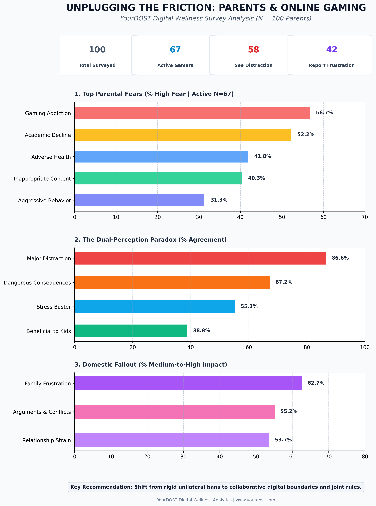

# Unplugging the Friction: Parents & Online Gaming Analysis
### YourDOST Digital Wellness Survey ($N = 100$)

[](yourdost_infographic_kpi.png)

Welcome to the official repository for the **YourDOST Digital Wellness Survey Analysis**. This project investigates parental attitudes, fears, domestic friction, and behavioral perceptions regarding youth online gaming. 

---

## 📊 Executive Summary & Infographic
The repository features an automated, presentation-ready 1-page portrait infographic (`yourdost_infographic_kpi.png`) summarizing the shift from raw survey outputs to strategic insights across **$N = 100$ total parents** ($n = 67$ active gaming households).

* **Active Households:** 67% ($67 / 100$)
* **Perceived Distraction:** 86.6% ($58 / 67$)
* **Reported Frustration:** 62.7% ($42 / 67$)

---

## ⚙️ Core SQL Analytical Architecture
To maintain absolute data integrity, non-gaming households (`kids_play_games = 'No'`, $N = 33$) were isolated using relational views (`gaming_survey_clean`) to prevent baseline percentage dilution.

### 1. Active Respondent Denominator Filter
```sql
SELECT 
    SUM(CASE WHEN stmt_distraction IN ('Agree', 'Strongly Agree') THEN 1 ELSE 0 END) AS distraction_agree_count,
    COUNT(*) AS total_active_respondents,
    ROUND(SUM(CASE WHEN stmt_distraction IN ('Agree', 'Strongly Agree') THEN 1 ELSE 0 END) * 100.0 / COUNT(*), 1) AS pct_distraction
FROM gaming_survey_clean
WHERE kids_play_games != 'No' 
  AND stmt_distraction IS NOT NULL;
```

### 2. Dual-Perception Cross-Tabulation Matrix
```sql
SELECT 
    stmt_stress_buster,
    stmt_distraction,
    COUNT(*) AS response_count,
    ROUND(COUNT(*) * 100.0 / (SELECT COUNT(*) FROM gaming_survey_clean WHERE kids_play_games IN ('Yes', 'Sometimes')), 1) AS percentage_share
FROM gaming_survey_clean
WHERE kids_play_games != 'No'
GROUP BY stmt_stress_buster, stmt_distraction
ORDER BY response_count DESC;
```

---

## 📈 Key Findings At a Glance

1. **The Fear Hierarchy:** **Gaming Addiction (56.7%)** and **Academic Decline (52.2%)** dominate parental anxiety, whereas immediate physical aggression or violence ranks lowest (**31.3%**).
2. **The Dual-Perception Paradox:** While **55.2%** of parents recognize gaming as a valid emotional *stress-buster*, an overwhelming **86.6%** simultaneously view it as an aggressive *distraction*.
3. **Domestic Fallout:** Gaming functions as an active daily battleground, inducing family frustration (**62.7%**), household arguments (**55.2%**), and parent-child relationship strain (**53.7%**).

---

## 🚀 Repository Structure
```text
├── yourdost_infographic_kpi.png    # 1-page visual infographic slide
├── README.md                      # Project documentation
└── queries.sql                    # Production SQL scripts & data cleaning pipelines
```

---
*Prepared for YourDOST Digital Wellness Analytics | Empowering Parents & Families.*
